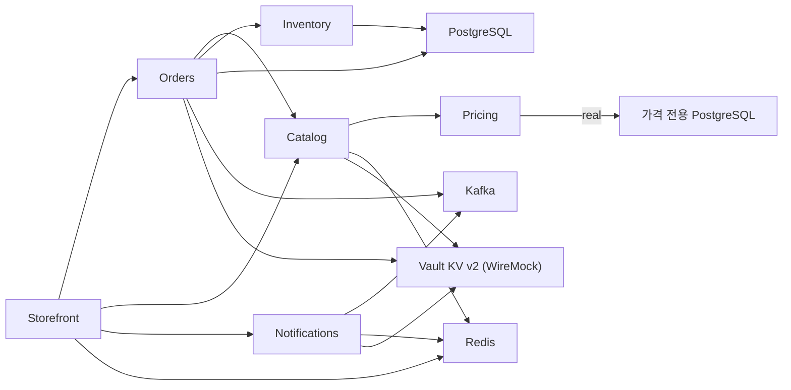

# 쇼핑몰 모노레포 데모

[English](README.md) · **한국어** · [Injector](../../../README.ko.md)

JVM 서비스 여섯 개와 공통 Java 라이브러리로 구성한 Gradle 모노레포다. Injector가 서비스는 로컬 Java 프로세스로 실행하고 PostgreSQL·Redis·Kafka·WireMock·Loki는 Docker Compose로 준비한다.



각 Java 서비스는 공용 Loki 노드에 구조화 로그도 보낸다.

| 서비스 | 실제 실행 동작 |
| --- | --- |
| Storefront | 주문·가격·배송 요청을 전달하고 checkout 횟수를 Redis에 기록한다. |
| Orders | Catalog와 Inventory에서 가격·재고를 조회한다. 주문 저장과 재고 차감은 같은 PostgreSQL 트랜잭션에서 처리하고 Kafka 이벤트를 발행한다. |
| Catalog | 가격을 Redis에 캐시하며 캐시가 비면 Pricing을 호출한다. |
| Pricing | `real`은 전용 PostgreSQL을 조회한다. `mock`은 WireMock에서 가격을 받고, 가격 전용 DB가 실행 순서에서 빠진다. |
| Inventory | Orders와 같은 PostgreSQL에서 재고를 조회한다. |
| Notifications | Kafka 주문 이벤트를 읽고 배송 상태를 Redis에 기록한다. |

## 실행

Docker Desktop, Injector Python 환경, JDK 17 이상이 필요하다. `JAVA_HOME`을 설정하고 해당 JDK의 `bin`을 `PATH`에 추가한다. Injector 저장소 루트에서 빌드한다.

```bash
bash verifier/gradlew -p examples/demo/monorepo installDist
```

Windows PowerShell에서는 `.\verifier\gradlew.bat -p examples/demo/monorepo installDist`를 사용한다. 첫 빌드는 필요한 Gradle과 Java 의존성을 다운로드한다.

```text
python injector.py plan storefront --project examples/demo/monorepo --profile real
python injector.py prepare storefront --project examples/demo/monorepo --profile real
```

웹에서 `examples/demo/monorepo`를 프로젝트로 열면 앱·프로필별 그래프를 볼 수 있다. `real`은 12개 노드를 준비한다. `--profile mock`으로 다시 준비하면 11개로 바뀐다. DB·캐시·브로커·로그 저장소는 세션마다 초기화된다.

```bash
curl http://127.0.0.1:19780/items/sample
curl http://127.0.0.1:19780/items/sample
curl -X POST http://127.0.0.1:19780/checkout -H 'X-Request-Id: shop-checkout-001' -H 'Content-Type: application/json' --data '{"id":"demo-order","sku":"sample","quantity":2}'
curl http://127.0.0.1:19781/orders/demo-order
curl http://127.0.0.1:19784/stock/sample
curl http://127.0.0.1:19780/deliveries/demo-order
```

가격 조회는 첫 요청에서 `miss`, 두 번째 요청에서 `hit`다. 주문 합계는 `real`에서 2598센트, `mock`에서 1998센트이며 재고는 10개에서 8개로 줄어든다. 같은 주문 ID와 상품·수량으로 재요청하면 저장된 주문을 반환하고 재고는 8개다. Kafka 처리가 끝날 때까지 배송 조회는 404를 반환한다. PowerShell에서는 아래 명령으로 주문을 보낸다.

```powershell
Invoke-RestMethod -Method Post -Uri 'http://127.0.0.1:19780/checkout' `
  -Headers @{'X-Request-Id' = 'shop-checkout-001'} -ContentType 'application/json' `
  -Body '{"id":"demo-order","sku":"sample","quantity":2}'
```

## Vault와 로그

Orders, Catalog, Notifications는 시작할 때 `127.0.0.1:19765`의 `GET /v1/secret/data/<service>`에서 설정을 읽는다. [`infra/vault/mappings/`](infra/vault/mappings/)의 WireMock 응답은 `X-Vault-Token`으로 데모 토큰을 받는다. Catalog와 Notifications는 같은 `cacheTtlSeconds` 키를 읽어 Redis 만료 시간을 각각 75초와 300초로 설정한다. Orders와 Notifications는 각자의 경로에서 `orderTopic`도 읽는다. [Vault KV v2 API](https://developer.hashicorp.com/vault/api-docs/secret/kv/kv-v2)

Java 서비스는 같은 `X-Request-Id`를 HTTP 호출과 Kafka 메시지에 전달한다. 위 주문을 보낸 뒤 `127.0.0.1:19764`의 Loki에서 요청 ID 하나로 각 서비스의 HTTP 상태, `order_published`, `notification_stored`를 조회할 수 있다. 로그 수집 필드는 경로·상태·서비스 등으로 제한하며 Vault 값, 토큰, HTTP 본문은 수집 대상에서 제외한다. [Loki HTTP API](https://grafana.com/docs/loki/latest/reference/loki-http-api/)

```bash
curl -G 'http://127.0.0.1:19764/loki/api/v1/query_range' \
  --data-urlencode 'query={app="injector-shop"} | json | requestId="shop-checkout-001"'
```

```powershell
$query = [uri]::EscapeDataString('{app="injector-shop"} | json | requestId="shop-checkout-001"')
(Invoke-RestMethod "http://127.0.0.1:19764/loki/api/v1/query_range?query=$query").data.result | ConvertTo-Json -Depth 8
```

`python injector.py stop --project examples/demo/monorepo`로 종료한다.

## 가격 조회 관측

실행 중인 쇼핑몰 세션을 종료한다. 아래 명령은 새 환경을 준비하고 `storefront → catalog` HTTP 호출을 기록한다.

```text
python injector.py observe-http storefront --project examples/demo/monorepo --profile real --scenario examples/demo/monorepo/scenarios/quote.json --output .local/shop-quote.json
```

코드 버전을 비교할 때는 같은 시나리오와 프로필로 각각 기록하고 `compare-http`로 비교한다. 실제 통합 테스트는 빌드 뒤 `INJECTOR_TEST_SHOP=1`을 설정하고 `python -m unittest discover -s tests -p test_shop_demo.py`로 실행한다.
