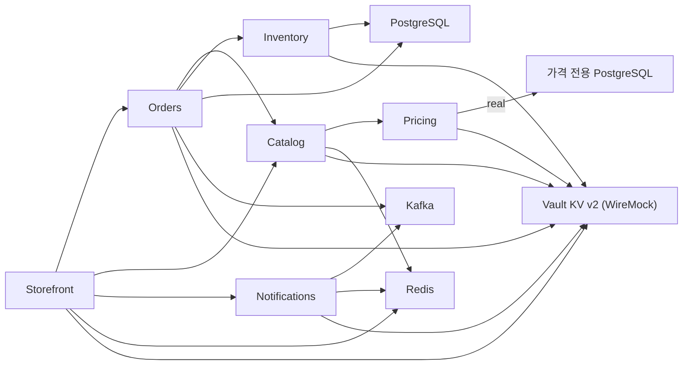

# 쇼핑몰 모노레포 데모

[English](README.md) · **한국어** · [Injector](../../../README.ko.md)

JVM 서비스 여섯 개와 공통 Java 라이브러리로 구성한 Gradle 모노레포다. Injector가 서비스는 로컬 Java 프로세스로 실행하고 PostgreSQL·Redis·Kafka·WireMock·Loki는 Docker Compose로 준비한다.



각 Java 서비스는 공용 Loki 노드에 구조화 로그도 보낸다.

| 서비스 | 실제 실행 동작 |
| --- | --- |
| Storefront | 주문·가격·배송 요청을 전달하고 checkout 횟수를 Redis에 기록한다. |
| Orders | Catalog와 Inventory에서 가격·재고를 조회한다. 주문 저장과 재고 차감은 같은 PostgreSQL 트랜잭션에서 처리하고 Kafka 이벤트를 발행한다. |
| Catalog | 가격을 Redis에 캐시하며 캐시가 비면 Pricing을 호출한다. |
| Pricing | `real`은 전용 PostgreSQL을 조회한다. `mock`은 WireMock에서 가격을 받고, 가격 전용 DB가 실행 순서에서 빠진다. |
| Inventory | Orders와 같은 PostgreSQL에서 재고를 조회한다. |
| Notifications | Kafka 주문 이벤트를 읽고 배송 상태를 Redis에 기록한다. |

## 실행

Docker Desktop, Injector Python 환경, JDK 17 이상이 필요하다. `JAVA_HOME`을 설정하고 해당 JDK의 `bin`을 `PATH`에 추가한다. Injector 저장소 루트에서 빌드한다.

```bash
bash verifier/gradlew -p examples/demo/monorepo installDist
```

Windows PowerShell에서는 `.\verifier\gradlew.bat -p examples/demo/monorepo installDist`를 사용한다. 첫 빌드는 필요한 Gradle과 Java 의존성을 다운로드한다.

```text
python injector.py plan storefront --project examples/demo/monorepo --profile real
python injector.py prepare storefront --project examples/demo/monorepo --profile real
```

웹에서 `examples/demo/monorepo`를 프로젝트로 열면 앱·프로필별 그래프를 볼 수 있다. `real`은 12개 노드를 준비한다. `--profile mock`으로 다시 준비하면 11개로 바뀐다. DB·캐시·브로커·로그 저장소는 세션마다 초기화된다.

```bash
curl http://127.0.0.1:19780/items/sample
curl http://127.0.0.1:19780/items/sample
curl -X POST http://127.0.0.1:19780/checkout -H 'X-Request-Id: shop-checkout-001' -H 'Content-Type: application/json' --data '{"id":"demo-order","sku":"sample","quantity":2}'
curl http://127.0.0.1:19781/orders/demo-order
curl http://127.0.0.1:19784/stock/sample
curl http://127.0.0.1:19780/deliveries/demo-order
```

가격 조회는 첫 요청에서 `miss`, 두 번째 요청에서 `hit`다. 주문 합계는 `real`에서 2598센트, `mock`에서 1998센트이며 재고는 10개에서 8개로 줄어든다. 같은 주문 ID와 상품·수량으로 재요청하면 저장된 주문을 반환하고 재고는 8개다. Kafka 처리가 끝날 때까지 배송 조회는 404를 반환한다. PowerShell에서는 아래 명령으로 주문을 보낸다.

```powershell
Invoke-RestMethod -Method Post -Uri 'http://127.0.0.1:19780/checkout' `
  -Headers @{'X-Request-Id' = 'shop-checkout-001'} -ContentType 'application/json' `
  -Body '{"id":"demo-order","sku":"sample","quantity":2}'
```

## Vault와 로그

애플리케이션 여섯 개는 모두 시작할 때 `GET /v1/secret/data/<service>`에서 설정을 읽는다. Java 프로세스는 `127.0.0.1:19765`를 사용한다. `mock`의 Pricing 대역은 Compose 네트워크의 `vault-mock:8080`에 접속한다. [`infra/vault/mappings/`](infra/vault/mappings/)의 응답은 `X-Vault-Token`으로 데모 토큰을 받는다. [Vault KV v2 API](https://developer.hashicorp.com/vault/api-docs/secret/kv/kv-v2)

| 서비스 경로 끝부분 | 사용하는 설정 |
| --- | --- |
| `storefront` | Redis 주문 횟수 카운터의 `checkoutCounterKey` |
| `orders` | Kafka 발행 토픽 `orderTopic` |
| `catalog` | 가격 캐시 만료 시간 `cacheTtlSeconds` 75초 |
| `pricing` | `real`의 DB 사용자 `dbUser`, `mock`의 대역 가격 `mockUnitCents` |
| `inventory` | 재고 조회용 DB 사용자 `dbUser` |
| `notifications` | Kafka 구독 토픽 `orderTopic`, 배송 상태 만료 시간 `cacheTtlSeconds` 300초 |

`mock`의 가격을 바꿔 보려면 Pricing 응답 파일의 `mockUnitCents`를 수정한 뒤 새 데모 세션을 시작한다. 가격 조회와 주문 합계에 새 값이 반영된다. [WireMock 응답 템플릿](https://wiremock.org/docs/response-templating/)

Java 서비스는 같은 `X-Request-Id`를 HTTP 호출과 Kafka 메시지에 전달한다. 위 주문을 보낸 뒤 `127.0.0.1:19764`의 Loki에서 요청 ID 하나로 각 서비스의 HTTP 상태, `order_published`, `notification_stored`를 조회할 수 있다. 로그 수집 필드는 경로·상태·서비스 등으로 제한하며 Vault 값, 토큰, HTTP 본문은 수집 대상에서 제외한다. [Loki HTTP API](https://grafana.com/docs/loki/latest/reference/loki-http-api/)

```bash
curl -G 'http://127.0.0.1:19764/loki/api/v1/query_range' \
  --data-urlencode 'query={app="injector-shop"} | json | requestId="shop-checkout-001"'
```

```powershell
$query = [uri]::EscapeDataString('{app="injector-shop"} | json | requestId="shop-checkout-001"')
(Invoke-RestMethod "http://127.0.0.1:19764/loki/api/v1/query_range?query=$query").data.result | ConvertTo-Json -Depth 8
```

`python injector.py stop --project examples/demo/monorepo`로 종료한다.

## 가격 조회 관측

실행 중인 쇼핑몰 세션을 종료한다. 아래 명령은 새 환경을 준비하고 `storefront → catalog` HTTP 호출을 기록한다.

```text
python injector.py observe-http storefront --project examples/demo/monorepo --profile real --scenario examples/demo/monorepo/scenarios/quote.json --output .local/shop-quote.json
```

코드 버전을 비교할 때는 같은 시나리오와 프로필로 각각 기록하고 `compare-http`로 비교한다. 실제 통합 테스트는 빌드 뒤 `INJECTOR_TEST_SHOP=1`을 설정하고 `python -m unittest discover -s tests -p test_shop_demo.py`로 실행한다.

## 주문 흐름 비교

쇼핑몰 워크트리를 양쪽 모두 빌드하고 같은 초기 데이터와 프로필을 사용한다. 명령은 각 워크트리를 차례로 실행하고 해당 세션을 종료하기 전에 Loki에서 기록을 가져온다.

```text
python injector.py compare-worktrees storefront --project "path/to/baseline-shop" --candidate-project "path/to/candidate-shop" --profile mock --scenario examples/demo/monorepo/scenarios/checkout-trace.json --output .local/checkout-trace
```

Injector는 주문 요청마다 새 `X-Request-Id`를 보내고, 대상 응답이 같은 ID를 돌려주는지 확인한다. 시나리오는 아웃바운드 HTTP 연결 네 개와 Kafka 발행·소비를 필수로 지정한다. 결과에는 HTTP 메서드·경로·상태, Kafka 토픽, 선택한 주문 응답 필드가 들어간다. 요청 ID·시각·하위 HTTP 본문·Kafka 본문은 제외한다. Verifier는 로그가 도착한 순서와 무관하게 이벤트 수와 값을 비교한다. 필수 이벤트가 제한 시간 안에 보이지 않으면 누락 목록과 함께 `INCONCLUSIVE`를 반환한다.

기록 두 개는 웹의 **HTTP·Kafka 관측 비교**에서 열 수 있다. 한쪽만 기록하려면 같은 시나리오를 `observe-http`에 전달하고, 이미 저장한 두 파일을 다시 비교하려면 `compare-http`를 사용한다.

요청 흐름 시나리오의 스키마 버전은 2다. 연동 앱은 Loki 스트림에 `app`과 `service` 라벨을, JSON 로그에 `requestId`, `event`, `details`를 둔다. HTTP 로그는 `http_request` 또는 `http_dependency`와 메서드·경로·상태를 기록한다. 아웃바운드 로그는 논리 의존성 이름도 기록한다. Kafka 로그는 토픽과 함께 `event` 또는 `details.traceKind`에 `kafka_publish`나 `kafka_consume`을 지정한다. 필수 이벤트가 모이면 잠시 더 조회해 기록이 안정되는지 확인한다. [시나리오·기록 스키마](../../../schemas/http-observation-v1.schema.json) · [Loki HTTP API](https://grafana.com/docs/loki/latest/reference/loki-http-api/#query-logs-within-a-range-of-time)

## 주문 버그 수정 검증

`mock` 프로필과 `checkout-evidence.json`을 사용한다. 주문을 보내기 전에 초기 재고와 기존 주문 유무를 확인한다. 주문 후에는 응답 금액 1,998센트, 저장된 주문, 최종 재고, Kafka 소비자가 저장한 배송 상태를 확인한다. `report.json`에서 양쪽의 노드별 기동 단계와 검사별 기대값·관측값을 확인할 수 있다.

```text
python injector.py compare-worktrees storefront --project "path/to/baseline-shop" --candidate-project "path/to/candidate-shop" --profile mock --scenario examples/demo/monorepo/scenarios/checkout-evidence.json --output .local/checkout-fix --prove-fix response
```

이 예제를 재현하려면 기준 복사본의 `infra/vault/mappings/pricing.json`에서 `mockUnitCents`를 `998`로 설정하고 후보에서는 `999`를 유지한다. 기준 버전은 1,996센트를 반환하므로 `response` 검사에서 실패한다. 후보는 모든 검사를 통과하고 필수 이벤트를 기록해야 한다. 회귀 검증에는 같은 시나리오를 `--prove-fix` 없이 실행한다. 매번 새 출력 폴더를 지정한다.

같은 두 복사본에서 수정 검증과 잘못된 수량 요청의 회귀 검사를 함께 실행한다.

```text
python injector.py verify-suite examples/demo/monorepo/scenarios/checkout-fix-suite.json --project "path/to/baseline-shop" --candidate-project "path/to/candidate-shop" --output .local/checkout-suite
```

회귀 검사는 첫 시나리오와 같은 주문 ID를 사용한다. 초기 재고가 10개이고 기존 주문이 없어야 시작한다. HTTP `400`, 최종 재고 10개, 주문·배송 기록 없음을 확인한다. 두 결과는 `summary.md`에서 검토할 수 있다.
