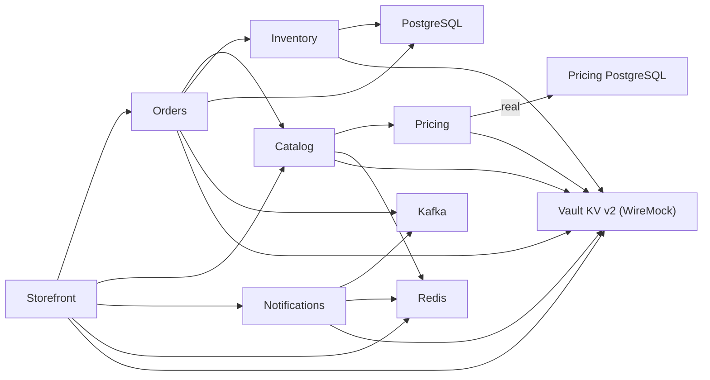

# Shop monorepo demo

**English** · [한국어](README.ko.md) · [Injector](../../../README.md)

This Gradle monorepo contains six JVM services and a shared Java library. Injector runs the services as local Java processes and prepares PostgreSQL, Redis, Kafka, WireMock, and Loki with Compose.



Each Java service also sends structured events to the shared Loki node.

| Service | Runtime behavior |
| --- | --- |
| Storefront | Routes checkout, quote, and delivery requests and increments a Redis counter. |
| Orders | Reads price and stock through Catalog and Inventory. Saves the order and updates stock in one PostgreSQL transaction, then publishes to Kafka. |
| Catalog | Caches prices in Redis and calls Pricing on cache misses. |
| Pricing | Reads its own PostgreSQL in `real`. In `mock`, WireMock supplies the price and the pricing database leaves the plan. |
| Inventory | Reads stock from the PostgreSQL instance used by Orders. |
| Notifications | Consumes order events from Kafka and writes delivery status to Redis. |

## Run the example

Use Docker Desktop, the Injector Python environment, and JDK 17 or newer. Set `JAVA_HOME` and put that JDK's `bin` on `PATH`. Build from the Injector root.

```bash
bash verifier/gradlew -p examples/demo/monorepo installDist
```

On Windows PowerShell, use `.\verifier\gradlew.bat -p examples/demo/monorepo installDist`. The first build downloads Gradle and Java dependencies as needed.

```text
python injector.py plan storefront --project examples/demo/monorepo --profile real
python injector.py prepare storefront --project examples/demo/monorepo --profile real
```

In the web UI, load `examples/demo/monorepo` to inspect the graph by app and profile. The real profile prepares 12 nodes. Run prepare with `--profile mock` to switch to 11 nodes. A fresh session initializes temporary database, cache, broker, and log storage.

```bash
curl http://127.0.0.1:19780/items/sample
curl http://127.0.0.1:19780/items/sample
curl -X POST http://127.0.0.1:19780/checkout -H 'X-Request-Id: shop-checkout-001' -H 'Content-Type: application/json' --data '{"id":"demo-order","sku":"sample","quantity":2}'
curl http://127.0.0.1:19781/orders/demo-order
curl http://127.0.0.1:19784/stock/sample
curl http://127.0.0.1:19780/deliveries/demo-order
```

A repeated quote changes from `miss` to `hit`. The checkout totals 2598 cents in real mode and 1998 in mock mode, and decreases stock from 10 to 8. Repeating the same order ID and items returns the saved order and keeps stock at 8. The delivery endpoint returns 404 while Kafka processing is pending. On PowerShell, submit the checkout with the command below.

```powershell
Invoke-RestMethod -Method Post -Uri 'http://127.0.0.1:19780/checkout' `
  -Headers @{'X-Request-Id' = 'shop-checkout-001'} -ContentType 'application/json' `
  -Body '{"id":"demo-order","sku":"sample","quantity":2}'
```

## Vault and logs

All six applications load settings at startup from `GET /v1/secret/data/<service>`. The Java processes use `127.0.0.1:19765`. The Pricing stub in `mock` uses `vault-mock:8080` on the Compose network. The fixtures under [`infra/vault/mappings/`](infra/vault/mappings/) expect the demo token in `X-Vault-Token`. [Vault KV v2 API](https://developer.hashicorp.com/vault/api-docs/secret/kv/kv-v2)

| Service path suffix | Settings used |
| --- | --- |
| `storefront` | `checkoutCounterKey` for the Redis metrics counter |
| `orders` | `orderTopic` for publishing to Kafka |
| `catalog` | `cacheTtlSeconds` of 75 seconds for prices |
| `pricing` | `dbUser` in `real` and `mockUnitCents` in `mock` |
| `inventory` | `dbUser` for stock queries |
| `notifications` | `orderTopic` for consuming Kafka events and `cacheTtlSeconds` of 300 seconds for delivery status |

To try a different `mock` price, change `mockUnitCents` in the Pricing fixture and start a fresh demo session. The stub's quote and the checkout total use the new value. [WireMock response templating](https://wiremock.org/docs/response-templating/)

The Java services carry `X-Request-Id` through HTTP and Kafka. After the checkout above, query Loki at `127.0.0.1:19764` for HTTP status events, `order_published`, and `notification_stored` under the same ID. Loki receives structured events with route, status, and service metadata. Vault values, tokens, and HTTP bodies are outside the collected fields. [Loki HTTP API](https://grafana.com/docs/loki/latest/reference/loki-http-api/)

```bash
curl -G 'http://127.0.0.1:19764/loki/api/v1/query_range' \
  --data-urlencode 'query={app="injector-shop"} | json | requestId="shop-checkout-001"'
```

```powershell
$query = [uri]::EscapeDataString('{app="injector-shop"} | json | requestId="shop-checkout-001"')
(Invoke-RestMethod "http://127.0.0.1:19764/loki/api/v1/query_range?query=$query").data.result | ConvertTo-Json -Depth 8
```

Use `python injector.py stop --project examples/demo/monorepo` to stop the session.

## Record a quote

Stop any active shop session first. The recorder prepares a fresh session and captures the `storefront → catalog` HTTP call.

```text
python injector.py observe-http storefront --project examples/demo/monorepo --profile real --scenario examples/demo/monorepo/scenarios/quote.json --output .local/shop-quote.json
```

To compare code versions, record the same scenario and profile into two files and use `compare-http`. For the live integration test, build the distributions, set `INJECTOR_TEST_SHOP=1`, and run `python -m unittest discover -s tests -p test_shop_demo.py`.

## Compare a checkout trace

Build both shop worktrees and start with equivalent data. Use one profile for both sides. The command starts each checkout in sequence and queries its Loki before stopping the session.

```text
python injector.py compare-worktrees storefront --project "path/to/baseline-shop" --candidate-project "path/to/candidate-shop" --profile mock --scenario examples/demo/monorepo/scenarios/checkout-trace.json --output .local/checkout-trace
```

Injector sends a fresh `X-Request-Id` with the checkout and requires the target to echo it. The scenario declares four outbound HTTP edges and both Kafka events. The artifact stores HTTP methods, paths, statuses, and Kafka topics, plus the selected checkout response fields. Request IDs, log timestamps, and bodies from downstream HTTP or Kafka are excluded. Verifier compares the event counts and values independently of log arrival order. Required events that fail to appear before the timeout produce `INCONCLUSIVE` with a list of missing events.

The two artifacts open in **HTTP·Kafka 관측 비교** in the web UI. To record just one checkout, use the same scenario with `observe-http`. To compare completed files again, use `compare-http`.

The trace scenario uses schema version 2. A compatible app emits Loki streams labeled `app` and `service`. Each JSON line carries `requestId`, `event`, and `details`. HTTP lines use `http_request` or `http_dependency` with method, path, and status. Outbound lines include the logical dependency. Kafka lines include the topic and declare `kafka_publish` or `kafka_consume` through `event` or `details.traceKind`. Checkouts capture the required events and a short settling window. [Scenario and artifact schema](../../../schemas/http-observation-v1.schema.json) · [Loki HTTP API](https://grafana.com/docs/loki/latest/reference/loki-http-api/#query-logs-within-a-range-of-time)
